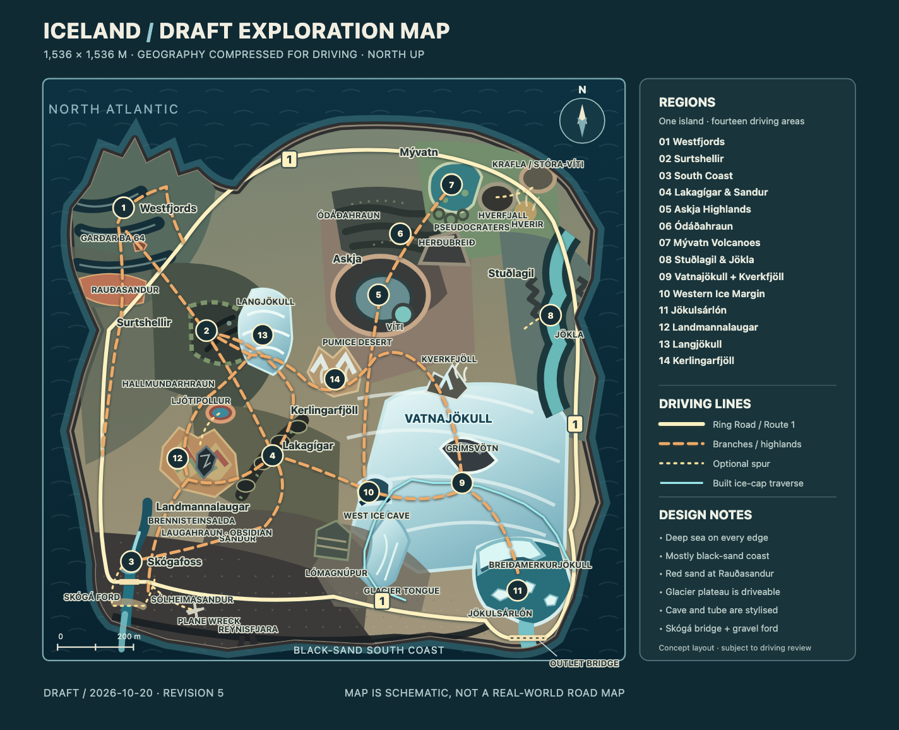

# Iceland spatial design and region cards

Concept revision 2, 2026-10-17. **North is up** (`-Z` in world coordinates),
east is right (`+X`). The square is 1,536 × 1,536 m; coordinates are design
anchors, not final spline or collider locations. Distances are compressed so
landmarks and roads can be driven in a game session. The sea surrounds an
irregular island inside the square; no terrain touches the outer edge.

Implementation began on 2026-10-17 with the Skógafoss/Skógá slice only.
See [progress](../../ICELAND_PROGRESS.md) and [actual pilot captures](pilot/).
The remaining map continues to describe planned regions.

## Draft map



[Open the editable SVG map](concept-map.svg). The image shows proposed
driving routes and compressed geographic relationships, not real roads.

## Current development map

The single current-world map is the [full-world aerial render](iceland-aerial.png),
3072 × 3072 pixels. The sampled surface-class SVG/PNG maps and separate southern
crop were retired at the user's request. The concept map above remains a separate
planning reference, not another rendering of current terrain.

This is an actual Three.js render of all 324 full-detail terrain chunks and the
game's scenery, including glacier solids, water, roads, bridges, icebergs and
ground details. It uses the live vertex colours, materials, Iceland light
colours/intensities, sun direction and game sRGB/ACES tone mapping, not the
retired maps' surface-category palette. North is up (`-Z`), east is right
(`+X`), and the view covers X/Z ±768 m. There are no labels or route overlays.

The development-only camera is orthographic and straight down. Distance fog is
disabled so the island is not hidden from aerial altitude, and the sun's shadow
coverage is expanded across the island instead of following a car-sized patch.
Thus it shows the real material colours from above, not a pixel-identical
driving-camera screenshot. Animated scenery is captured at its initial state.
No game geometry, streaming limits or runtime camera settings are changed.

Regenerate with `node --import tsx scripts/render-iceland-aerial.ts`.
The script follows the actual-model browser-rendering approach in
`scripts/render-car-thumbnails.ts` and uses installed Playwright Chromium
with Metal on the current macOS development host.

## Text schematic

```text
                                  N
                 deep sea / mostly black coast
     Westfjords ── branch ── Route 1 ── Mývatn / Krafla
          │                       Ódáðahraun       │
     Surtshellir ─ Langjökull       Herðubreið   Stuðlagil
          │             Kerlingarfjöll   Askja     │
          │                   │        Kverkfjöll │
     Landmannalaugar ─ Lakagígar ─ ice cave ─ Vatnajökull
       Ljótipollur                              Grímsvötn
          │                                      │
     Skógafoss ─ plane wreck ─ Reynisfjara ─ Lómagnúpur
     Skógá bridge ═════ Route 1 ═══ sandur ═══ Jökulsárlón
                                              outflow bridge
                          southern sea
                                  S
```

The drawn links indicate game routes, not real roads. The actual southern
ordering is Skógafoss, Sólheimasandur plane wreck, Reynisfjara, then the
eastward sandur and Jökulsárlón. Lakagígar lies southwest of Vatnajökull;
Askja and Herðubreið lie to its north. Ódáðahraun spreads between Askja and
the Mývatn highland approach; Mývatn/Krafla are farther north,
and Stuðlagil lies east of the highland corridor. Surtshellir is in
Hallmundarhraun in west-central Iceland, southeast of the Westfjords. The
Westfjords form a separate northwest peninsula connected by a long coastal road.

## Anchor layout

### Additional highland and gateway reservations — 2026-10-17

The SVG/PNG above now includes these additions and all fourteen regions.
They remain reservations for future terrain work. The Ring Road is implemented
as a continuous first-pass route around the main island; future regional terrain
must preserve its corridor. Westfjords has a separate planned branch.

| Addition | Proposed X, Z; envelope | Design and placement |
| --- | --- | --- |
| **Landmannalaugar** | -350, 235; about 230 × 210 m | North/northeast of Skógafoss, west of Lakagígar. One coherent region with Brennisteinsalda's folded ochre, rusty red, cream and muted green slopes, glossy black **Laugahraun** blocks, a sheltered basin and scattered fumaroles. |
| **Ljótipollur** | -300, 115; about 65 × 45 m | Optional crater-lake overlook northeast of the Landmannalaugar basin. Blue water below a rusty red rim; a short return loop, not another full region. |
| **Lómagnúpur** | -5, 465; about 105 × 130 m | A tall, layered cliff prow at the western entrance to Skeiðarársandur, southwest of Vatnajökull and west of Jökulsárlón. The coast road bends around its foot, revealing the ice cap across the outwash plain. A visual gateway, not a stone arch. |
| **Langjökull** | -180, -100; about 150 × 230 m | An elongated, compact second ice mass east/southeast of Surtshellir. A moraine approach, broad snow saddle and two graded exits connect the west to the central highlands. Keep Vatnajökull clearly dominant. |
| **Kerlingarfjöll** | 5, 0; about 150 × 150 m | East of Langjökull and north/northeast of Landmannalaugar: pale orange rhyolite ridges, isolated snow patches and steaming Hveradalir valleys. Confirmed by the user as a full region. |
| **Kverkfjöll** | 300, 25; about 110 × 100 m | Northern Vatnajökull margin, southeast of Askja. Include as a compact ice/volcano/geothermal shoulder within the existing glacier region, with a glacial gorge and steam. Do not substitute it geographically for Kerlingarfjöll. |

**Recommended space allocation:** add Landmannalaugar and Langjökull as two
regions, and the confirmed Kerlingarfjöll as a third: **14 regions total**.
Lómagnúpur belongs to the existing sandur/coast region; Ljótipollur belongs to
Landmannalaugar. Include Kverkfjöll within Vatnajökull, without adding a fifteenth region. Preserve
at least 30–50 m of transition ground between authored envelopes and reserve
the existing western ice-cave corridor. These are design envelopes, not final
chunk bounds or evidence that the routes are driveable yet.

**New western loop:** Skógafoss → Landmannalaugar → Langjökull →
Hallmundarhraun/Surtshellir → western coast → Skógafoss. An eastern branch
from Landmannalaugar joins Lakagígar; a Kerlingarfjöll pass joins the
Askja approach north of the western ice cave. Use a clear valley road through
Landmannalaugar and a separate rough obsidian option; keep the colourful
mountain faces readable from the car. Steam stays beside the driving line.
Langjökull gets a shorter snow traverse with visible land on each side; the
long cave and broad summit expedition remain on Vatnajökull.

**Kverkfjöll fit decision:** its 110 × 100 m envelope occupies the northern
edge of the existing glacier allocation. Keep the 300, 25 anchor east of the
western ice-cave corridor and southeast of Askja. Give it a glacier-side road
with a short overlook loop, dark volcanic ribs, a snow-filled cleft and local
steam. Reserve the ridge northward for the Askja connector; the main glacier
plateau still continues south to Grímsvötn. No second large cave, crater lake or
independent road network is needed. Validate the final corridor in terrain
blockout before filling this reserved envelope with collision.

**Glacier choice:** recommend Langjökull over Hofsjökull for this map. Its
association with Hallmundarhraun strengthens the existing west route.
Hofsjökull would fit northeast of Kerlingarfjöll, but would use scarce central
space near the Askja connection and repeat another ice-cap traverse. Keep it
as an alternative, not a fourth obligatory snow destination. Both are major
Icelandic glaciers, smaller relative to Vatnajökull rather than small glaciers.

**Art distinction:** Landmannalaugar uses folded multicolour slopes and sharp
glassy lava; Kerlingarfjöll uses pale eroded ridges, snow pockets and dense
valley steam; Hverir remains an open ochre mud/fumarole field. Lómagnúpur is
a sheer layered coastal prow; Herðubreið remains an isolated inland table
mountain. This prevents each addition from repeating an existing silhouette.

Sources checked for this extension:

- [Environment Agency: Fjallabak map and geology](https://www.ust.is/library/Skrar/utgefid-efni/Baeklingar/ust_Fjallabak_b%C3%A6klingur_EN.pdf): Landmannalaugar, Brennisteinsalda, Laugahraun, Ljótipollur and rhyolite/obsidian.
- [Katla Geopark: Lómagnúpur](https://www.katlageopark.com/geosites/geology-culture/lomagnupur/): layered cliff and relationship to Skeiðarársandur/Vatnajökull.
- [Kerlingarfjöll: landscape and geology](https://kerlingarfjoll.is/um-kerlingarfjoll/sagan): rhyolite, summer ice patches and Hveradalir; between Langjökull and Hofsjökull.
- [Visit North Iceland: Kverkfjöll](https://www.northiceland.is/en/destinations/nature/the-highlands/kverkfjoll): northern Vatnajökull, glacial gorge and geothermal activity.
- [Visit West Iceland: Langjökull](https://www.west.is/en/place/langjokull-glacier): western ice cap and Hallmundarhraun connection.
- [Visit South Iceland: glaciers](https://www.south.is/en/glaciers-and-glacier-activities): comparative glacier scale.

### Original region anchors

| Area / landmark | Approx. X, Z (m) | Spatial role |
| --- | ---: | --- |
| Westfjords fjord road / Rauðasandur | -575, -450 | Northwest peninsula; red sand faces the southwest inlet. |
| Garðar BA 64 | -500, -520 | Nearby Patreksfjörður shore, not on Rauðasandur itself. |
| Skógafoss start | -520, 475 | Southwest interior/coast transition. |
| Skógá ford | -535, 585 | Shallow downstream crossing between Skógafoss and the sea, on an optional gravel track south of the road bridge. |
| Sólheimasandur wreck | -365, 635 | Open black outwash south of Route 1, between the waterfall and Reynisfjara. A faint game trail reaches the wreck from the road. |
| Reynisfjara / Reynisdrangar | beach approach -263, 595; columns -222, 641; cave -174, 656; stacks -177 to -111, 716 to 732 | Route 1 beach spur, a broad dry driving shelf below the column-built cliff, shallow nearshore water, Hálsanefshellir-inspired cave and three collidable offshore stacks. |
| Lakagígar fissure and sandur | -150, 210 | Southwest of the ice cap, inland from south coast. |
| Askja / Askja's Víti | 120, -230 | North of Vatnajökull; large caldera and smaller crater. |
| Herðubreið | 250, -345 | Isolated table mountain northeast of Askja. |
| Ódáðahraun traverse | 205, -405 | Extensive lava wilderness between Askja and Mývatn. |
| Mývatn / Skútustaðagígar | 310, -515 | Green lake and southern pseudocrater shore. |
| Hverfjall / Hverir / Krafla | 440, -515 | East and northeast of Mývatn, with two distinct volcanic craters. |
| Surtshellir / Hallmundarhraun | -335, -130 | West-central lava field on the inland Westfjords-to-south corridor. |
| Stuðlagil / Jökla | 580, -170 | Eastern basalt river corridor. |
| Vatnajökull / Grímsvötn | 310, 260 | Dominant southeast ice cap and exposed volcanic rim. |
| Western ice cave | 115, 290 | Fictional drive-through cave at western ice margin. |
| Breiðamerkurjökull / Jökulsárlón | 485, 535 | Outlet glacier calves into south-edge lagoon. |
| Jökulsá bridge / sea outlet | 500, 650 | Short outflow from lagoon to southern sea. |

Reserve roughly 80–150 m of water between most coastline and world edge.
Some fjord inlets penetrate farther, giving real coast turns and overlooks.
Keep the southwest-to-southeast coast road inland of the beach shelf, with
short optional descents to black sand. The Westfjords red sand is the deliberate
exception to the mostly black perimeter.

The Sólheimasandur wreck sits on a [black volcanic outwash plain](https://www.south.is/en/destinations/nature/nature/solheimasandur).
The short drivable access in this compressed game world is fictional; visitors
reach the real wreck on foot, and vehicle access is prohibited there.

Reynisfjara's basalt columns are part of the lower Reynisfjall cliff, beneath
its irregular rock cap, with [Hálsanefshellir](https://www.south.is/en/destinations/nature/geopark/reynisfjara-reynisfjall-og-reynisdrangar)
opening beside them. The [user's side-view reference](https://gti.images.tshiftcdn.com/6769863/x/0/czarna-plaza-reynisfjara-6.jpg?ixlib=php-3.3.0&w=883)
shows this relationship. In the game, a level black-sand corridor lies between
the cliff and a shallow, transparent coastal band before deep water.

## Route graph

- **Ring Road / Route 1:** Skógá bridge → Sólheimasandur → Reynisfjara →
  Lómagnúpur / south sandur → Jökulsárlón bridge → eastern corridor → Mývatn
  → northern return → west coast → Skógafoss. Stuðlagil and Westfjords connect
  by regional branches. The real Route 1 also bypasses the Westfjords; see
  [Visit Iceland](https://www.visiticeland.com/article/the-ring-road/).
- **Central-west cross-link:** Westfjords → Hallmundarhraun/Surtshellir →
  Lakagígar or Skógafoss. This makes the tube a substantial inland detour
  rather than moving it to the Mývatn region.
- **Highland loop:** south sandur → Lakagígar → western ice cave → ice-cap
  plateau/Grímsvötn → safe eastern descent → lagoon road. A branch from the
  cave/plateau skirts the glacier north to Askja, crosses Ódáðahraun past
  Herðubreið, and reaches Mývatn.
- **Optional routes:** broad glacier summit line, rough Lakagígar lava edge,
  riverbank overlooks, Hverfjall rim approach, Surtshellir tube passage, Stuðlagil overlook,
  Westfjords upper switchbacks, and the unmarked airplane-wreck spur.

The dramatic forms are not all mandatory obstacles. Every cliff, pool, caldera,
water edge, or narrow cave has a discernible wide bypass and reset clearing.
Geothermal pools and active steam are visual hazards outside driving lines.

The Jökulsá bridge approaches now hold a straight east-west road at `z = 650`
from `x = 420` through `x = 575`, beyond the outer cable anchors at `x = 439/561`.
The eastern turn then eases toward `(595, 650)`, `(620, 610)` and `(635, 530)`.
Keep the full road width and its shoulders clear of all four stays and anchor
blocks; checking the centreline or bridge deck alone misses approach conflicts.

## Region design cards

### Implemented Vatnajökull slice — 2026-10-20

The cairned traverse now leaves Route 1 at `(188, 610)`, climbs west of the
southern tongue through `(120, 370)` and `(205, 290)`, crosses the roughly
110 m-high plateau at `(260, 300)` / `(315, 300)`, and descends east through
`(555, 390)` to the existing road at `(635, 530)`. It has an 8 m graded
half-width with broad eased shoulders, and solid paired cairns outside that
easy line. The lowest western pair and final two eastern pairs are omitted at
the Ring Road junctions, keeping the asphalt and entries clear. The internal
start/reset ID is `vatnajokull`.

Grímsvötn's low brown shoulders now surround `(310, 143)` with
approximately 48 × 34 m radii. The centre moved 89 m north, about 40% of the
distance from its former `(310, 232)` position to the northern ice edge.
The through-route is unchanged. The former overlook branch to `(335, 270)` was
removed at the user's request, including its grading and cairns: only the passage
between the two entries remains. Ice fills the interior and buries the southeastern
half of the rim; only about 44% of the circumference is exposed. The highest
rock reaches about 122 m, roughly 12 m above the snowfield. The rim is streamed rock terrain,
not a decorative mesh without collision. Its ice/rock contacts retain the
separate glacier roof and exact sampled visible/solid surfaces.

The cap now spreads farther north and west, with about 0.172 km² of sampled
exposed ice across the cap and its two tongues. The northern head reaches near
`z = 9` at `x = 310`. The lower southern tongues and accepted calving face are
retained. Shared glacier bounds drive the mesh extent as well as terrain and
traction, including the newly covered northern chunks.

Coastal terrain outside the Ring Road now descends toward low shore ground
instead of inheriting the inland escarpment. This applies around the island;
named landmarks such as Skógafoss, Reynisfjall and Lómagnúpur retain their relief.
All four island corners are rounded, preserving the road and its dry approaches.
The northern interior remains reserved base terrain, not a completed new region.

The cyan line on the SVG/PNG concept map marks this implemented traverse.
The other highland routes remain proposals. The cave around `(115, 290)`
and the northern Askja/Kverkfjöll connector are still reservations, not
completed passages. [Current captures](vatnajokull/) show arrival, low rim,
raised caldera, slopes and the preserved southern glacier contacts.

| Region | Approach silhouette and palette | Easy line / harder choice / connection |
| --- | --- | --- |
| **South Coast** | Green escarpment and wide white Skógafoss above the Skógá plunge pool; black Sólheimasandur; Reynisfjara's vertical basalt and Reynisdrangar sea stacks. | Inland coast road and lagoon bridge; marked shallow Skógá ford downstream of the falls plus beach/outwash driving to the plane wreck; exits to sandur, Westfjords and Lakagígar. |
| **Jökulsárlón** | Blue lagoon, scattered white/black ice, sheer striated Breiðamerkurjökull front, black beach beyond the short river. Ice mixes tabular slabs, split ridges, tilted slabs and fractured blocks, with independently varied clear/frosted pieces and a few substantially larger lagoon and beach forms. | Broad shore loop and bridge with straight approaches beyond its cable anchors; optional iceberg viewpoint; exits west along coast and uphill toward ice cap. |
| **Vatnajökull** | Largest white mass, gently domed and fairly flat on top; a low brown half-rim at Grímsvötn emerges from the snow farther north. | One cairned passage across the ice between the graded western ascent and eastern descent. No crater-overlook spur. Northern Askja connection remains planned. |
| **Western Ice Margin** | Layered blue ice portal cut into the western ice-cap edge. | Wide, long drive-through cave with daylight at both ends; optional ice-roof viewpoint; exits to Lakagígar, plateau and Askja approach. |
| **Lakagígar and Sandur** | Long row of dark cones with green moss on rock, then open grey/black braided outwash. | Firm corridor alongside fissure and broad dry sandur channels; optional rough pumice/lava lines; exits to south coast and ice margin. |
| **Askja Highlands** | Huge dark caldera, smaller turquoise Askja Víti, pale pumice flats and Herðubreið's flat top. | Wide caldera-side road and desert corridor; optional higher rim line; exits south to glacier and north into Ódáðahraun. |
| **Ódáðahraun** | Long, black, broken lava field with sparse moss and varied flow ages; Askja/Herðubreið recede while Mývatn's greener ground appears ahead. | Firm wandering traverse in both directions and optional rock challenges; clear entries at Askja and Mývatn. |
| **Mývatn Volcanic Country** | Green lake/islets and Skútustaðagígar, Hverfjall's dark ring, Krafla and steaming ochre Hverir. | Lakeshore loop and Hverir bypass; optional crater/lava side roads; exits west to northern coast and east to Stuðlagil. |
| **Stuðlagil and Jökla** | River in a narrow canyon with dense polygonal basalt columns. | Wide rim track and bridge return; optional low rocky overlook outside the river; exits to Mývatn and eastern coast. |
| **Surtshellir and Hallmundarhraun** | Mossy dark lava field with a broken-roof lava tube in west-central Iceland. | Broad lava-field approach and drive-through cave with daylight openings and safe turnouts; exits toward Westfjords, Lakagígar and south coast. |
| **Westfjords** | Layered fjord walls, dark inlet water, red Rauðasandur, rusted Garðar BA 64 on the nearby shore. | Coast switchbacks with turnouts and beach access; optional upper ridge route; returns to north and south coast. |

**Hidden discovery:** a small unmarked geothermal ice hollow where dark volcanic
rock touches the western ice margin. It should be found by following subtle
steam through a side cleft, have a safe turn-around, and reveal a distinct
view rather than a new collectible requirement. This is invented for the game;
the Sólheimasandur wreck remains a separate, real-place discovery.

## Naming and geographic notes

- Use **Vatnajökull**, **Grímsvötn**, **Jökulsárlón**, **Breiðamerkurjökull**,
  **Askja**, **Víti**, **Herðubreið**, **Ódáðahraun**, **Mývatn**, **Hverfjall**, **Krafla**,
  **Námaskarð**, **Námafjall**, **Hverir**, **Surtshellir**, **Hallmundarhraun**,
  **Stuðlagil**, **Skógafoss**, **Skógá**,
  **Reynisfjara**, **Reynisdrangar**, **Lakagígar**, **Rauðasandur**,
  **Garðar BA 64**, and **Sólheimasandur** in player-facing text.
- Label the colourful geothermal field **Hverir (Námaskarð)**: Hverir is
  the field east of Námafjall, beside the Námaskarð pass. Emphasise bubbling
  mud and fumaroles; avoid making the whole field a row of tall geysers.
- Askja's small crater is **Víti**. Krafla has a *different* crater,
  **Stóra-Víti**; keep them separate. Hverfjall is near Mývatn, while
  Herðubreið is the isolated table mountain near the Askja highlands.
- **Grímsvötn** is a mostly subglacial volcanic caldera. Model a dark rocky
  exposed rim/steep nunatak-like wall rising from ice, not a fully bare
  symmetrical volcano. The broad plateau driving is a game adaptation.
- The ice cave on Vatnajökull's **west edge** is an invented placement to
  satisfy the route plan. Do not present it as a specific named real cave;
  well-known cave tours around Breiðamerkurjökull are farther south/east.
- **Surtshellir** is a lava tube in the **Hallmundarhraun** lava field in
  West Iceland, near the highland edge. It belongs on the west-central route,
  well away from Mývatn. The drive-through form is a game adaptation, not a
  claim that vehicles can enter the real cave.
- **Sandur** is a glacial outwash plain, so its branching meltwater channels
  and deposits should read differently from a dune desert. Pumice belongs
  chiefly to the volcanic highland transition around Askja/Lakagígar.
- **Ódáðahraun** is a vast lava wilderness adjoining Askja and the route
  toward Mývatn. Its long black traverse should feel unlike the greener,
  smaller lava formations immediately around Mývatn.
- The **Skógá** flows over Skógafoss and continues across the south-coast
  lowland. The game's shallow ford is a designed crossing downstream of the
  plunge pool, with a dry bypass; it is not a claim about a real-world ford.

## Sources for geography and visual design

- [Vatnajökull National Park: ice cap and subglacial Grímsvötn](https://www.vatnajokulsthjodgardur.is/en/melting-glaciers/vatnajokullglacier)
- [Vatnajökull National Park: Jökulsárlón, river bridges and ice caves](https://www.vatnajokulsthjodgardur.is/en/areas/jokulsarlon)
- [Visit Mývatn: Mývatn, Hverir, Krafla, Hverfjall, Askja and Herðubreið](https://www.visitmyvatn.is/is/afthreying/arstidir/the-wonders-of-myvatn/volcanic-lava-fields)
- [Iceland Touring Association: Ódáðahraun and Askja trail](https://www.fi.is/en/hiking-trails/trails/oskjuvegur)
- [Environment Agency of Iceland: Skógafoss and Skógá](https://www.ust.is/english/visiting-iceland/protected-areas/south/skogafoss/)
- [Visit West Iceland: Surtshellir and Hallmundarhraun](https://www.west.is/en/destinations/nature-1/hallmundarhraun-lava-field)
- [Visit Austurland: Stuðlagil and the Jökla river](https://www.east.is/en/place/studlagil-canyon)
- [Visit Iceland: black beaches and Reynisdrangar](https://www.visiticeland.com/article/black-beaches-iceland/)
- [Visit Iceland: Lakagígar southwest of Vatnajökull](https://www.visiticeland.com/things-to-do/hotel-klaustur/)
- [Visit Westfjords: Rauðasandur red beach](https://www.westfjords.is/en/place/raudasandur)
- [Visit Westfjords: Garðar BA 64 in Patreksfjörður](https://www.westfjords.is/en/place/gardar-ba)

These sources guide names and relative placement. No source imagery is copied
into the game.

## Skógafoss refinement and map reproduction

The user's [reference photograph](https://rumbomundo.com/wp-content/uploads/2020/03/99432c3c7ee3fd5f-skogafoss.jpg) informs the vertical fall and recessed cliff.
The implemented drop is vertical, with only small turbulent surface displacement;
it does not follow the ground slope. Upper water reaches a horizontal lip, then
falls into a larger impact plume. River water is transparent, including the
shallow ford. The paved Ring Road crosses a restored Skógá bridge at (-531, 530); the
ford stays on the optional gravel loop. The cliff uses the terrain mesh itself,
without a separate mossy shell. The upper river joins the fixed waterfall brink. The plateau channel starts
in a rounded source pool and meanders through eased gravel/moss banks; the lower
river widens into a plunge pool and retains protected bridge/ford approaches.
Water is clipped to the terrain and its shallow opacity depends on depth. The
ocean excludes the river footprint, meeting it at the mouth without a second
water surface under the riverbed. The paved Ring Road is classified as Asphalt.

Edit `concept-map.svg`, then run `node artifacts/iceland/render-map.mjs` from
the repository root to regenerate `concept-map.png`. The map is a geographic
concept, not a screenshot of currently completed terrain.

### Jökulsárlón outlet correction — 2026-10-19

The concept map now places Route 1's bridge south of the lagoon across the
short Jökulsá outlet river. Keep the lagoon basin open, with the glacier front
on its inland side, and a visible river reach on each side of the bridge before
the sea. The bridge must connect dry banks; it must not span the lagoon.

User references for bridge placement and proportions:
- [Outlet bridge and Diamond Beach](https://localguide.is/wp-content/uploads/2025/06/bridge-at-Diamond-Beach-and-Jokulsarlon-Glacier-Lagoon-Iceland-1024x683.jpg)
- [View along the outlet toward the lagoon and glacier](https://www.holdurcarrental.is/static/files/_blob/j6s0ztcqgnm7hcvz62xuku.png)

### Lómagnúpur / sandur implementation — 2026-10-19

The reserved cliff anchor is now authored terrain. A gravel detour runs from
(-90, 595) past the southern cliff foot to Route 1 at (130, 608). The adjacent
Skeiðarársandur has low dry branching channels and sparse gravel; the road
continues east toward the reserved lagoon region. Start: `?area=iceland&start=lomagnupur`.

Geographic reference: [Katla Geopark, Lómagnúpur](https://www.katlageopark.com/geosites/geology-culture/lomagnupur/).
The cliff is compressed to game scale and shares its terrain collision.

### Ridge, glacier gateway and Jökulsárlón — 2026-10-19

Lómagnúpur now continues north into a broad highland ridge, rather than closing
as an isolated mountain. Its steep upper rock face sits over a long gentler
gravel apron, following the [user's reference](https://dalshofdi.is/wp-content/uploads/2018/01/4693763095_f1501378c4_b.jpg).
A southern ice-field tongue reaches (154, 518), just east of the gateway, with
a separate dry approach ending at (146, 540). It connects to the developing
southern Vatnajökull ice field; the summit/Grímsvötn routes remain future work.

Jökulsárlón is centred at (485, 553), with a solid ice calving front near
z=493, an irregular tidal lagoon and a continuous short outlet to the sea.
Route 1 crosses only that outlet at (500, 650), on a suspension bridge with
solid deck, rails and towers. The west-bank gravel viewpoint returns to Route 1.
Icebergs are irregular fixed solids in deep water; bob/drift is deferred so
rendering and collision remain consistent during this static terrain gate.
Start: `?area=iceland&start=jokulsarlon`.

### Glacier margin refinement — 2026-10-20

Both southern tongues and the connected cap now use an irregular, sharp
ice/ground boundary derived from their physical shape. The initial hard-colour
terrain split was rejected: it exposed a dark basal skirt and lost most of the
calving water contact. Ice is now a separate solid mesh with a sampled roof,
land margins tapering onto the bed and ice walls buried into the ground.
The lagoon bay reaches the full-height calving walls, which extend underwater.
Preserve the taller hills framing both tongues; only excavate below the ice,
not the surrounding valley sides. Keep unequal outlines and crevasses when
extending the plateau or western ice cave. Current low-camera, calving waterline
and supplied-angle views: `glacier-solids-final/`.
The subsequent basal-band correction buries land-margin closing walls below
the bed instead of leaving a uniform exposed ice lip. Current land-contact
views: `glacier-no-band/`; the calving face remains full-height underwater.
