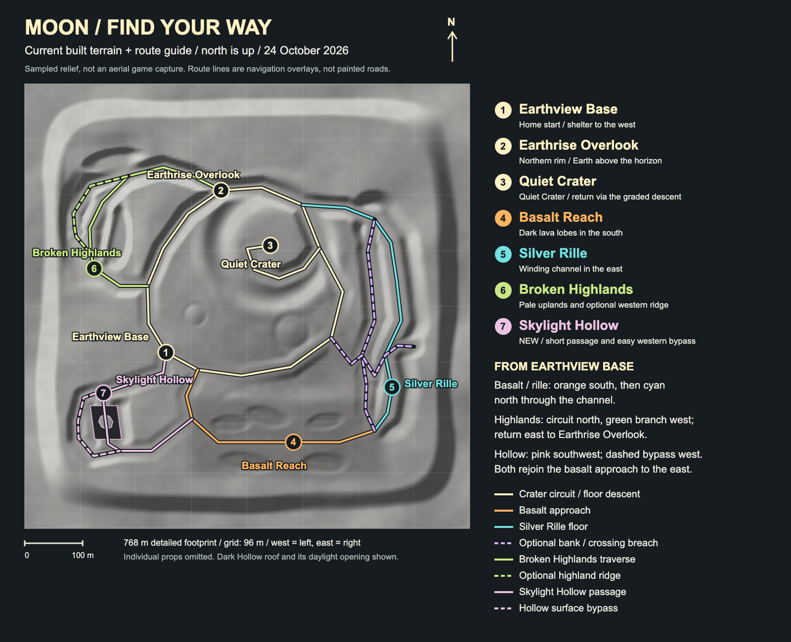
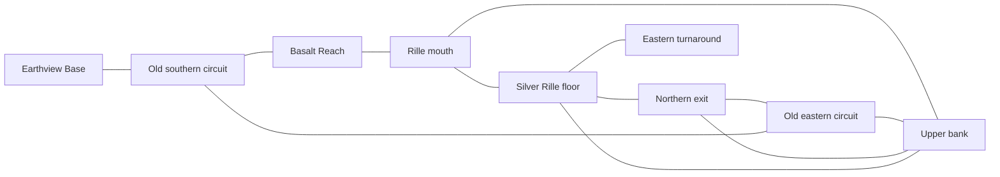

# Moon: Earthview, basalt–rille, Broken Highlands and Skylight Hollow

North is -Z; east is +X. Coordinates are invented, in world metres.
This is a compact playable experiment, not a completed Moon world.
The user accepted Broken Highlands and authorized the **Moon / Low-gravity
preview** home tile on 2026-10-24 for easy iPad testing. The tile and regional
links work in production; physical-device acceptance remains open.

## Navigation map

[Open the current map](moon-map.png) or the [zoomable SVG](moon-map.svg).
North is up. Orange leads south across **Basalt Reach**; cyan follows
**Silver Rille** north to the crater circuit. Dashed purple marks the optional
bank and crossing breach. Green leads into **Broken Highlands** and returns
to Earthrise Overlook; dashed green marks its optional western ridge.
Pink leads southwest to **Skylight Hollow**; dashed pink is the western surface
bypass. The dark roof overlay includes its actual daylight opening.
Numbers match the seven regional starts.

This is sampled terrain relief with navigation overlays, not an aerial game
capture or an in-game map. Props are omitted; unbuilt regions are not shown.
Regenerate from current terrain/routes/starts:
`node --import tsx scripts/render-moon-map.ts`.

| Place | Anchor X/Z | Identity and route |
| --- | --- | --- |
| Earthview Base | -140 / 80 | Ivory/gold landing shelter, solar racks and a communications mast, beside a level rover clearing. Two directions around the crater. |
| Earthrise Overlook | -45 / -200 | Broad northern shoulder with a small scientific instrument. Turn south for a basin panorama, north to frame Earth over the highlands. |
| Quiet Crater floor | 40 / -105 | Pale bowl with a broad turnaround. Eastern graded descent returns to the circuit; no mandatory jump or drop. |
| Basalt return | 75 / 105 | Darker, lower open ground on the southern circuit. Provides a change in value, scale and driving rhythm without adding water or vegetation. |
| Basalt Reach | 80 / 235 | Dark southern lava plain with overlapping low flow lobes, pressure ridges and sparse angular basalt clusters. Open approach to the rille mouth; regional entry `basalt-reach`. |
| Silver Rille | 250 / 140 | Winding eastern channel floor, higher western-bank alternative and a crossing breach. Regional entry `silver-rille`. |
| Broken Highlands | -264 / -65 | Pale fractured shelves, a broad climb and optional 43 m western ridge, returning east to Earthrise Overlook. Regional entry `broken-highlands`. |
| Skylight Hollow | -248 / 150 | Short partly buried lava passage, central daylight collapse and easy western bypass. Both reconnect south and return east to the basalt approach. Regional entry `skylight-hollow`. |

The western circuit climbs gradually from the base to the overlook. The northern
arc passes the crater rim and meets the eastern descent. The eastern and southern
return crosses darker ground and closes at the base. Small secondary craters and
scattered rocks remain outside the easy route and its shoulders.

Basalt Reach's first flat/darker treatment proved too subtle from the user's
northern approach (X=98.706, Z=182.326). Five finite, irregular lava lobes now
frame the southern through line, with approximately 3–5 m of relief and low
pressure crests rather than repeating dune waves. Darker crust remains neutral
grey. Twelve varied, flat-faceted slabs in four sparse clusters add readable
angular detail; their whole-footprint undersides are buried and their actual
meshes are solid. The original corridor, starts, palette, light and handling
remain unchanged. The user accepted this identity pass before authorizing Highlands.

Broken Highlands occupies the western/northwestern space without widening the
render footprint. Unequal shelves, a western spine and an eastern buttress
support two actual terrain clefts. Five pale, grounded solid outcrops provide
sparse scale cues outside the driving shoulders. The clearing has a shared
level departure before the main and ridge climbs separate; both reconnect at
the northern saddle. The main line then returns to the original overlook.

The shelter is centred at X=-165, Z=85 on the gentler western ground. Its level
deck clears the highest point under the entire footprint; separate legs and
feet support it without enclosing the open underside. Ground-contact footings
extend below their lowest footprint sample, with matching solid collision.

## Sky and lighting

No atmospheric fog or bright horizon band. A restrained fill light keeps the
shadowed rover usable; directional sunlight creates the primary terrain relief.
Earth is a locally generated, stylized blue/green sphere with baked cloud shapes,
not a geographically accurate globe or downloaded texture. Its direction stays
fixed as the camera moves; terrain can reveal or conceal it. Its angular size is
deliberately enlarged for the toy-world presentation.

The single 512 x 256 map uses coherent spherical cloud noise, smoothly blended
coasts/ice, matching longitude/pole samples and trilinear mip filtering. Do not
restore the original periodic cloud dashes or binary low-resolution shore mask.
Texture work stays at sky creation, not in the frame loop.

## Exploration vehicles

Moon defaults to Lunar Rover; Mars Scout remains a separate choice on both Moon
and Mars. The lunar body has a short forward cabin, upright three-pane windshield
with solid angled corner faces, rectangular headlights, a simple low bumper,
separate rear solar/equipment deck and silver dish rims with six actual openings
per face. Its wheels are exposed: no wheel guards or guard stays. Both use the same four wheel positions,
collision envelope, mass, suspension and handling. Lunar tuning belongs to the
world, not the car model. Earth car preferences remain independent.
Front, corner and side panes share their sill/header heights; side edges follow
the actual front/rear cabin slopes, maintaining an evenly spaced corner pillar.
All cabin panes share a light-independent dark-blue tint to avoid the previous
face-dependent glossy colour mismatch. Solar panels keep their lit material.
See [current vehicle views](lunar-rover/webkit-tablet/moon-rover-front.png) and
[following-camera view](lunar-rover/webkit-tablet/moon-rover-driving.png).
[Head-on front view](lunar-rover/webkit-tablet/moon-rover-head-on.png) shows
the wide central pane, narrow corner panes and paired rectangular lamps.
[Side-window profile](lunar-rover/webkit-tablet/moon-rover-side.png) shows
the fitted glazing and identification bars below the glass.

### Lunar Nomad alternative

Available separately with `?area=moon&car=lunar-nomad`, and on Mars using the
same `car` parameter. The existing Lunar Rover and Mars Scout remain available;
neither world's default changes.
The user accepted Nomad as a separate choice on 2026-10-24.

The user's [body-geometry inspiration](https://media.sketchfab.com/models/7392236a94e24114a3f28e780fbb437b/thumbnails/3256b6ac1f474c9da63982fb28e2fafa/247d309cce424afd92a88a4f7ed7b4d8.jpeg)
suggests a single long faceted pressure hull, a large sloping windshield, narrow
side glazing, side access and roof equipment. Nomad is original local geometry,
not an imported model: it adapts those broad forms to the game's **two axles and
four unchanged wheel contacts**, shortening the three-axle reference's rear body.
No source texture, logo, decal or remote asset is loaded by the game.

Warm ivory hull, muted teal rear bands/side equipment, charcoal chassis and
uniform dark-amber glazing distinguish it from the existing blue-glazed Rover.
An actual chamfered hull supports the front glass; side panes follow its face
equations. A continuous high roof covers the rear compartment, with a solar
array and four small forward lamps. Capped silver rims have diagonal dark
inserts. Reused tire shape/tread and mesh batching keep the visual budget small.
Mass, colliders, wheelbase, suspension and world-specific handling are unchanged.
The [new builder](../../src/game/lunar-nomad.ts) does not call the Scout body
builder. [Actual game views](lunar-nomad/) retain front, profile and driving angles.

## Pilot performance contract

The rendered ground is one fixed mesh: 4 m lattice in the 768 m-wide pilot,
24 m lattice in the far continuation, with matching 4 m transition edges.
Globally evaluated normals avoid a separate coarse/fine shading seam.
Terrain collision uses those exact fine triangles in a moving 3 x 3 core.
Most scenery is batched; small rocks do not cast individual shadows.

This buys a clean horizon without fog or render activation spikes at pilot
scale. It does not establish that a larger, more detailed Moon can avoid LOD.
Physical iPad performance remains separate from landscape acceptance and desktop
frame measurements.

## Current driving-height evidence

- [Earth above the rim](earth-texture/webkit-tablet/driving.png)
- [Current Earth detail](earth-texture/webkit-tablet/close.png)
- [Exposed texture seam](earth-texture/webkit-tablet/seam.png)
- [Grounded shelter](grounding/webkit-tablet/shelter.png)
- [Shelter foot contact](grounding/webkit-tablet/shelter-feet.png)
- [Solar support contact](grounding/webkit-tablet/solar.png)
- [Actual collision-boundary drive, earlier hardware probe](hardware-chromium/collision-crossing.png)
- [Basin panorama](webkit-tablet/exposed-overlook.png)
- [Basalt Reach arrival](basalt-rille/webkit-tablet/basalt-reach.png)
- [Silver Rille floor and Earth](basalt-rille/webkit-tablet/silver-rille.png)
- [Upper-bank return](basalt-rille/hardware-chromium/upper-bank.png)
- [Crossing breach](basalt-rille/webkit-tablet/breach-floor.png)
- [Eastern shoulder looking back](basalt-rille/chromium-tablet/eastern-shoulder.png)
- [Actual excursion drive](basalt-rille/webkit-tablet/real-drive.png)
- [Basalt before, reported approach](basalt-identity/webkit-tablet/before-reported-view.png)
- [Basalt after, same camera](basalt-identity/webkit-tablet/reported-view.png)
- [Current basalt arrival](basalt-identity/webkit-tablet/arrival.png)
- [Grounded angular crust](basalt-identity/webkit-tablet/grounded-crust.png)
- [Current basalt driving](basalt-identity/webkit-tablet/real-drive.png)
- [Broken Highlands arrival](broken-highlands/webkit-tablet/arrival.png)
- [Broad shelf climb](broken-highlands/webkit-tablet/shelf-climb.png)
- [Exposed western ridge and Earth](broken-highlands/hardware-chromium/western-ridge.png)
- [Northern return](broken-highlands/webkit-tablet/northern-return.png)
- [Terrain fracture, eastern-bank photo view](broken-highlands/webkit-tablet/fracture.png)
- [Actual Highlands drive](broken-highlands/webkit-tablet/real-drive.png)
- [Skylight Hollow arrival](skylight-hollow/webkit-tablet/arrival.png)
- [Northern portal](skylight-hollow/webkit-tablet/north-portal.png)
- [Passage interior](skylight-hollow/webkit-tablet/interior.png)
- [Daylight opening from inside](skylight-hollow/webkit-tablet/daylight-from-inside.png)
- [Southern portal](skylight-hollow/webkit-tablet/south-portal.png)
- [Roof and surface bypass](skylight-hollow/webkit-tablet/roof-and-bypass.png)
- [Actual Hollow drive](skylight-hollow/webkit-tablet/real-drive.png)
- [Base connector, actual portal arrival](hollow-connectors/webkit-tablet/base-connector-forward-arrival.png)
- [Southern return, reverse approach](hollow-connectors/webkit-tablet/basalt-return-reverse-arrival.png)

The default base start looks toward the crater; the shelter sits west of the
rover, not in that forward view. These are actual game captures, not concept
artwork. Earlier hardware-probe images predate the footing correction.
The basalt–rille captures show the current extension. Its separate
[hardware frame probe](basalt-rille/hardware-chromium/performance.json) retains
16.7 ms median / 16.8 ms p95 desktop cadence at five views/driving samples,
with the same terrain budget. Physical iPad acceptance remains open;
see [current progress](../../MOON_PROGRESS.md) for exact coverage and limits.
The later basalt-identity pass adds 240 scenery triangles and one batched
rock material/collider, not terrain triangles. Its
[fresh hardware probe](basalt-identity/hardware-chromium/performance.json)
retains 16.7 ms median / 16.7–16.8 ms p95 desktop cadence.
Broken Highlands adds another 100 scenery triangles and one batched solid
material/collider. Its [hardware probe](broken-highlands/hardware-chromium/performance.json)
also retains 16.7 ms median / 16.7–16.8 ms p95 across the clearing, climb,
ridge, northern return and an actual collision-boundary crossing. Construction
is somewhat more expensive; see progress for measured samples and coverage.
The Skylight Hollow roof uses 592 scenery triangles, one mesh/material and one exact
static triangle collider, without enlarging the terrain mesh or moving core.
Highlands and Hollow's corrected permanent roof shade were accepted by the user
on 2026-10-24. Both retain physical-device acceptance
as a separate gate. The [current Hollow hardware probe](skylight-hollow/hardware-chromium/performance.json)
uses Nomad and the corrected sunlight filter: seven 240-frame desktop Metal
samples retain 16.7 ms median / 16.7–16.8 ms p95, including the passage's
collision-boundary crossing. This is not iPad acceptance. Both full connectors
now have actual two-way driving evidence in Chromium/WebKit, in addition to
the earlier passage/bypass coverage; see [connector evidence](hollow-connectors/).

## Approved staged layouts

The user approved a compact connected expansion on 2026-10-23. See the
[staged plan](../../MOON_BUILD_PLAN.md#approved-continuation--2026-10-23).

### Skylight Hollow layout — 2026-10-24

After accepting Lunar Nomad, the user authorized continuing the Moon plan.
The southwest uses the existing footprint, lighting and low-gravity handling.
From Earthview Base, leave south through -145 / 115, then turn west through
-205 / 135 to the clearing at **-248 / 150**, facing south.
Direct entry: `http://localhost:5173/?area=moon&start=skylight-hollow&car=lunar-nomad`.

The slightly bending trench carries the passage south through Z=172–230.
A roughly 24 m-long central collapse is genuinely open to the black sky.
The roof has irregular thick exposed portals and closed upper/lower skins;
its lateral margins are buried in the actual Float32 terrain shoulders.
Rendered vertices also provide solid collision, including the skylight rims,
instead of an invisible box over the opening. A weak local material bounce
keeps the shaded rock distinguishable from the black sky without fog, lamps
or changing the accepted global lighting.

The roof's sunlight occlusion is now permanent: a small fixed-direction depth
atlas blocks direct sunlight on terrain, scenery and the rover regardless of
the rover-centred shadow map. Real roof triangles determine the shaded areas
and skylight/portal light patches. Ambient fill remains unchanged. The roof no
longer needs dynamic shadow casting; nearby rover shadows remain dynamic.
Filtered comparisons follow the receiving face's slope at each texel, avoiding
the false repeated teeth previously visible on the southern portal wall.
The user accepted the corrected roof face and shade on 2026-10-24.
See [near/far/disabled comparisons](static-tube-shadows/) and the latest progress
entry for texture budgets, exact pixel evidence and device limits.

The bypass leaves the clearing west on a level departure, reaches -282 / 158
**before** turning south outside the whole roof, then climbs gently to 18 m.
Both alternatives meet at -220 / 250 and return east through -165 / 250
to the existing basalt approach at -95 / 195. There is no mandatory jump,
deep cave, new building or enlarged terrain/collision ring.

References: Mars's `lavaTubeGeometry`, terrain trench and real-driving checks,
plus Moon's existing full-width route grading, exact scenery collision and
disposal. Adaptations: one bounded roof, neutral lunar materials, thicker
irregular portals, consistent outward-facing rims and a genuine surface bypass.
Moon's single-sided material deliberately exposes winding mistakes rather
than masking them with double-sided rendering.

### Broken Highlands layout — 2026-10-23

After accepting the basalt identity pass, the user authorized continuing.
Use the western/northwestern space inside the existing detailed footprint:
no render expansion, new handling, sky changes or buildings.

| Feature | Anchor X/Z | Connection and identity |
| --- | --- | --- |
| Broken Highlands clearing | -264 / -65 | A safe regional start on the broad ascending shelf. Leave the old western circuit at -172 / -35, curve west through -220 / -35, then climb toward the pale fractured uplands. |
| Main highland traverse | -272 / -135 to -205 / -225 | Gradually rising, broad shelves around unequal massifs and real terrain clefts. Continue east through -145 / -240 to Earthrise Overlook, closing a loop on the old circuit. |
| Optional western ridge | -300 / -160 | A higher, more exposed 43 m branch from the new clearing, joining the same northern saddle. Continuous two-way line; no required jump, tight tunnel or dead-end drop. |

The terrain, not a colour-only change or dense rock scatter, must provide the
identity. Keep fractured shoulders solid and in agreement with rendering;
use only a few full-footprint-grounded pale outcrops outside route clearance.
Retain 91,008 terrain triangles and at most nine active terrain chunks.
Update the map from live routes/starts and inspect arrival, shelf, ridge and
overlook sightlines in both engines. Physical-iPad acceptance remains open;
this is a bounded continuation, not a larger-world performance claim.

Implemented with a shared level departure at -270 / -90 before the branches
climb. From Earthview Base, follow the western circuit north and turn west at
-172 / -35. The green map line leads to the clearing and then back east to the
overlook. Direct entry: `http://localhost:5173/?area=moon&start=broken-highlands`.

### Basalt–rille layout — 2026-10-23

The first extension uses the unused southern and eastern ground inside the existing
768 m detailed footprint. Do not widen the render mesh or collision core.
Preserve the northern Earth sightline, old crater circuit and base foundations.

| Feature | Anchor X/Z | Connection and sightline |
| --- | --- | --- |
| Basalt Reach | 80 / 235 | Leave the old southern circuit at -85 / 110, curve south onto a broad dark plain, then turn east toward the channel mouth. Low flow ridges and existing pale-lit rocks provide scale without new buildings. |
| Silver Rille | 250 / 140 | Follow the winding floor north from 220 / 215 to 248 / -110, then grade back into the old eastern crater circuit at 95 / -175. Banks frame the view ahead; Earth remains fixed to the north. |
| Upper bank alternative | 198 / 85 | A higher, more turning-intensive route joins the same southern mouth and northern exit. It is optional, not a mandatory narrow shelf. |
| Crossing breach | 238 / 85 | A shorter, steeper connection from the old eastern circuit crosses the bank route, descends to the floor, and climbs to a turnaround on the eastern shoulder at 288 / 70. It creates shorter loops, not a required jump. |

This diagram shows route connections, not an overhead terrain rendering.

The plain needs broad low-relief driving, whereas the rille needs a readable
continuous depression with both banks, not a flat stripe between decorative
walls. Floor, banks and breaches must be one sampled terrain surface with the
same rendered and collision triangles. Both new regional clearings need direct
entry and nearest-region reset. The higher bank and shorter breach provide the
optional more demanding lines; the longer channel approach remains gentle.

Budget: retain 91,008 terrain triangles, one fixed terrain mesh, at most nine
active terrain colliders and existing material batching. Add no dense prop
layer or human hardware for this slice. Compare construction/frame cadence
against the pilot before calling the slice ready. Physical-iPad acceptance
remains open independently of desktop results.
